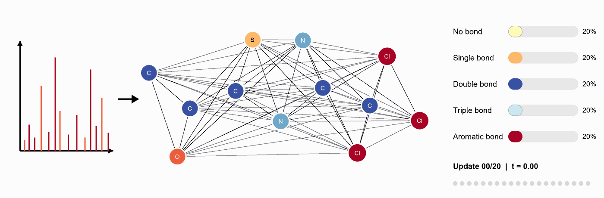
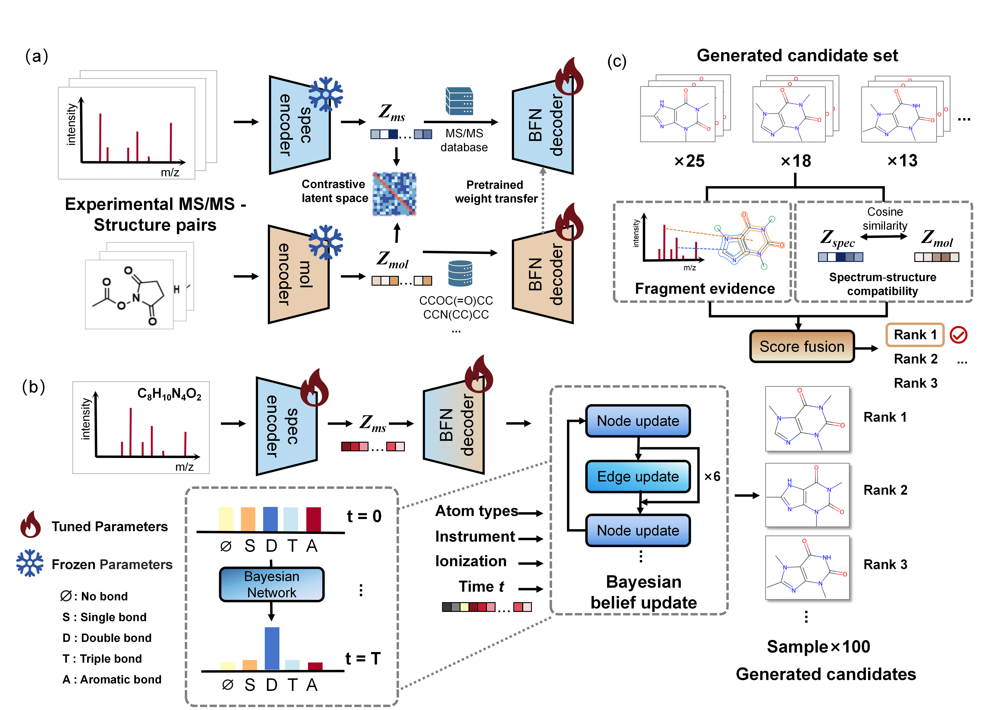

# MS²Forge

**Bayesian Flow Network for De Novo Molecular Structure Generation from Tandem Mass Spectra**

<p align="center">
  
</p>

MS2Forge generates candidate molecular structures from tandem mass spectra and molecular formulas, then reranks them using fragment evidence and spectrum–structure compatibility. This repository provides the permutation-equivariant, formula-conditioned FiLM implementation for MassSpecGym (MSG) and NPLIB1.



## Installation

The supplied environment targets Linux x86-64 with Python 3.9 and CUDA 11.8. The PyG wheel URLs in `environment.yml` are specific to this platform.

```bash
conda env create -f environment.yml
conda activate ms2forge
export PYTHONPATH="$PWD${PYTHONPATH:+:$PYTHONPATH}"
export MS2FORGE_ASSETS="$HOME/ms2forge_assets"
```

Set `MS2FORGE_ASSETS` to your external data directory and `DATASET` to `msg` or `nplib1`. `PYTHONPATH` enables direct execution of scripts in subdirectories.


All model weights are available on [Google Drive](https://drive.google.com/drive/folders/1i60al-sxjCqLjn0YOObrS7amT1Lm7yM3?usp=sharing).
A demo is also available in the same folder for reproducibility and evaluation.

## Training


### Encoder alignment

Set data paths in `configs/encoder.yml`; default: 8 GPUs. Add `--gpus 1` for a single GPU.

```bash
python -m encoder.prepare --stage finetune
python -m encoder.train --stage finetune  # Add --dataset nplib1 for NPLIB1.
```

Fine-tuning uses the pretrained encoder specified in `configs/encoder.yml`.

After fine-tuning, compute both embedding caches and prepare decoder inputs:

```bash
python -m encoder.export              # Add --dataset nplib1 for NPLIB1.
python -m utils.prepare pipeline      # Add --dataset nplib1 for NPLIB1.
```


### Graph2Mol

Set data paths and training parameters in `configs/graph2mol.yml`. Decoder configs default to `dataset: msg`; change it to `nplib1` to switch data and output paths. An explicit dataset in `run.py` overrides the YAML value:

```bash
python run.py graph2mol  # Or: python run.py nplib1 graph2mol
```

Checkpoints are saved under `<dataset>/output/graph2mol/`; a verified shared pointer is published to `shared/checkpoints/graph2mol.json` for the MS2Mol parent.

### MS2Mol

Set data paths in `configs/ms2mol.yml`. Both datasets use the same `parent` Graph2Mol checkpoint; their Zmol caches must use a compatible graph encoder:

```bash
python run.py ms2mol  # Or: python run.py nplib1 ms2mol
```

Checkpoints are saved under `<dataset>/output/ms2mol/`; sampling automatically reads the latest saved checkpoint through `latest.json`.

### Reranker training

Train the complete EvidenceRank → Stage A → SSR pipeline with `python -m rerank.train` (MSG), or `python -m rerank.train nplib1`. Configure paths in `configs/rerank.yml`. Common-loss features are computed directly; auxiliary models are not required.

## Inference

Set the MS2Mol checkpoint, Zms cache, prepared input table and sampling parameters in `configs/sample.yml`.

```bash
python sample.py msg  # For NPLIB1: python sample.py nplib1
```

## Reranking

Training writes the frozen model bundle to `$MS2FORGE_ASSETS/<dataset>/output/rerank_training/models/`. `rerank.py` reads `configs/rerank.yml` and uses that dataset’s model bundle and test caches. Use an empty reranking output directory.

```bash
python rerank.py msg  # For NPLIB1: python rerank.py nplib1
```


## Acknowledgements

- [MassSpecGym](https://github.com/pluskal-lab/MassSpecGym) and its [dataset](https://huggingface.co/datasets/roman-bushuiev/MassSpecGym).
- [DiffMS](https://github.com/coleygroup/DiffMS) for NPLIB1/CANOPUS preprocessing and benchmark splits.
- [FragHub](https://github.com/eMetaboHUB/FragHub) for spectrum-library integration.

## License

This code is released under the [MIT License](LICENSE). External datasets, weights and dependencies retain their respective terms.
